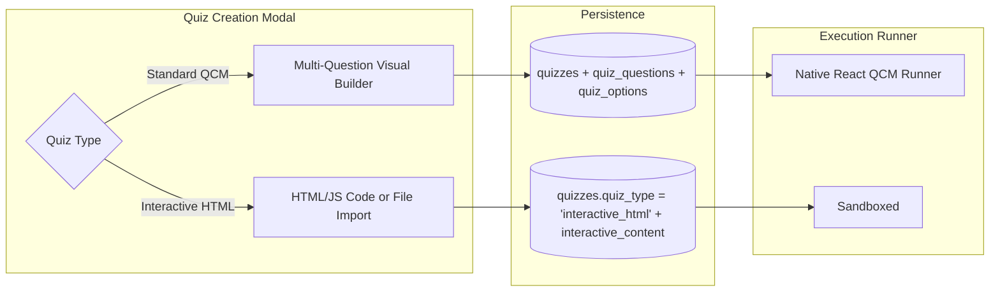

# validily-IGL4 UX Audit, Usability Transformation & Agent Execution Specification

> **Target System**: validily-IGL4 (University Exam-Prep Platform for IGL4 Software Engineering)  
> **Stack**: Next.js 16.4.1 (App Router, Turbopack, React 19), Supabase (PostgreSQL 15, GoTrue Auth, Storage), Tailwind CSS / Vanilla CSS  
> **Status**: Audit Completed — Ready for Agent Execution  
> **Operating Constraint**: Non-breaking additive changes, local-only execution, clean build and test passes required at each phase.

---

## 1. Executive Summary & Context

**validily-IGL4** is an academic platform designed to help university software engineering students (specifically the IGL4 curriculum) organize course modules, prepare for tests (DS / TP / Examens Principaux & Rattrapage), solve self-assessment quizzes, and create revision cheat sheets.

### Core Problems Identified
1. **Disconnected Navigation**: High-level sidebar links ("Semestres", "Matières", "Examens", "Fichiers") act as competing silos rather than a cohesive funnel into the core study hub (`/subjects/[subjectId]`).
2. **Blocked Custom Interactive Quizzes (User-Reported Defect)**: Students attempting to create or practice interactive HTML/code-based drills (e.g. for Flutter or distributed systems like `SAR-revision.html`) find the platform completely blocked:
   - Database schema strictly accepts single relational text questions.
   - Creation modal only supports 1 question with 3 plain-text choices.
   - Quiz runner only executes hardcoded React radio buttons with zero sandbox execution support.
3. **Passive Repository Syndrome**: The platform acts as a static document drive rather than an active study partner. Revision status is toggled manually with static badges rather than reflecting quiz attempts, re-testing missed questions, or tracking real retention.
4. **Authoring Dead-Ends**: The primary `/quizzes` page is read-only. Quiz creation is buried inside a module tab and restricted to 1 question.
5. **Technical Debt**: `src/components/workspace/subject-learning-workspace.tsx` is an overgrown monolith (1,535 lines) that combines 5 tabs, 4 modals, state transitions, and metrics.

---

## 2. System Architecture & Component Inventory

```mermaid
graph TD
  User([Student / Faculty Browser]) --> AppShell[WorkspaceShell + AppHeader + AppSidebar]
  AppShell --> Routes[Next.js 16 App Router]
  
  subgraph Client & Workspace Pages
    Routes --> Home["/ (Cockpit & Flow Selector)"]
    Routes --> Subjects["/subjects & /subjects/[subjectId]"]
    Routes --> Library["/library (Resource Library)"]
    Routes --> Quizzes["/quizzes & /quizzes/[quizId]"]
    Routes --> Notes["/notes (Cheat Sheets)"]
    Routes --> Admin["/admin (Curriculum Management)"]
  end

  subgraph Logic & Data Access Layer
    Routes --> Repo[repository.ts - In-Memory TTL Cache]
    Routes --> Actions[Server Actions: quiz, resource, note, admin]
    Routes --> API["/api/upload & /api/download"]
  end

  subgraph Persistence Layer (Supabase)
    Repo --> PostgreSQL[(Supabase PostgreSQL 15)]
    Actions --> PostgreSQL
    API --> PostgreSQL
    API --> S3Bucket[(Supabase Storage: 'academic-resources')]
    Actions --> GoTrue[(Supabase Auth)]
  end
```

### Key Files in Workspace
- **Navigation & Layout**:
  - `src/components/layout/workspace-shell.tsx`: Main shell wrapper with mobile drawer state.
  - `src/components/layout/app-sidebar.tsx`: Desktop and mobile sidebar navigation.
  - `src/components/layout/app-header.tsx`: Top bar, search trigger, upload CTA, user menu.
- **Subject Workspace**:
  - `src/app/(workspace)/subjects/[subjectId]/page.tsx`: Subject workspace loader.
  - `src/components/workspace/subject-learning-workspace.tsx`: Central study hub (1,535 lines).
- **Quiz System**:
  - `src/app/(workspace)/quizzes/page.tsx`: Global quiz list.
  - `src/app/(workspace)/quizzes/[quizId]/page.tsx`: Single quiz loader.
  - `src/components/quizzes/quiz-runner.tsx`: Interactive React quiz runner.
  - `src/lib/actions/quiz-actions.ts`: Server actions for quiz and attempt creation.
- **Resource Management**:
  - `src/app/(workspace)/library/page.tsx`: Global resource explorer.
  - `src/components/resources/upload-dropzone.tsx`: Drag-and-drop file uploader.
  - `src/app/api/upload/route.ts`: Upload handler (MIME validation, storage, DB insert).
  - `src/lib/supabase/repository.ts`: Data access layer with 30s TTL in-memory caching.

---

## 3. Evidence-Based Findings Register

| ID | Issue Description | Root Cause & File Evidence | Impact & Severity | Target Solution |
|---|---|---|---|---|
| **F-01** | **Custom HTML Quiz Blocked (Flutter)** | Database lacks HTML fields (`quiz_type`, `interactive_content`); `CreateQuizModal` allows only 1 question with 3 options; `quiz-runner.tsx` only renders radio buttons. Reference: `SAR-revision.html` in workspace root cannot be loaded. | **P0 (Critical)** | Dual-mode quiz engine: (1) Visual multi-question QCM builder, (2) Sandboxed `<iframe>` runner with `postMessage` score synchronization. |
| **F-02** | **Read-Only Quizzes Directory** | `src/app/(workspace)/quizzes/page.tsx` renders only quiz cards. No "Nouveau Quiz" button. Creation is obscured inside subject tabs. | **P1 (High)** | Add prominent "Créer un Quiz" CTA on `/quizzes` with subject selector modal. |
| **F-03** | **Monolithic Workspace Component** | `src/components/workspace/subject-learning-workspace.tsx` is 1,535 lines long, bundling 5 tabs, 4 modals, state transitions, and metrics. | **P1 (High)** | Refactor into modular subcomponents (`/workspace/tabs/`, `/workspace/modals/`). |
| **F-04** | **Fragmented / Competing Navigation** | `app-sidebar.tsx` lists "Semestres", "Matières", "Examens", and "Fichiers" as competing links leading to redundant flat tables. | **P1 (High)** | Reorganize sidebar into 3 logical tiers: Academic Navigation, Revision Tools, and Administration. |
| **F-05** | **Absence of Study Continuity** | Home page (`src/app/(workspace)/page.tsx`) displays static greetings and quick shortcuts, but lacks a "Reprendre la révision" cockpit showing last studied subject or pending quizzes. | **P1 (High)** | Add a dynamic resume card linked to `revision_progress` and recently accessed items. |
| **F-06** | **Unformatted Note Authoring** | `src/components/notes/notes-manager.tsx` uses plain textareas without markdown preview, code syntax highlighting (Dart, Python, C++), or formula support. | **P2 (Medium)** | Provide split-screen or tabbed Markdown preview with syntax highlighting. |
| **F-07** | **Accessibility & Contrast Deficits** | Muted text `#68748A` on `#F4F6FA` fails WCAG AA (~3.8:1 ratio). Interactive elements lack consistent focus-visible rings. | **P2 (Medium)** | Darken secondary text token to `#525E75` (>= 4.5:1 ratio) and add global `focus-visible:ring-2` styles. |
| **F-08** | **Missing Exam Session Facets** | Database resources have tags for session (`principale`, `rattrapage`), but `library/page.tsx` lacks quick filter pills to separate them. | **P2 (Medium)** | Add session facet pills (Toutes, Session Principale, Rattrapage) to library and subject views. |

---

## 4. Technical Architecture: Dual-Mode Quiz Engine

### Root Cause Analysis: Flutter Custom HTML Quizzes
Students create interactive web applications (using HTML, CSS, JavaScript, canvas, or audio) to test complex topics (such as Flutter widget lifecycle, state management, or distributed algorithms). An exact example exists in the workspace root: `SAR-revision.html` (1,468 lines of standalone interactive revision with audio players, tabbed sections, and quiz logic).

Under the current architecture:
1. `public.quizzes` only has relational child tables: `quiz_questions` and `quiz_options`.
2. `quiz-actions.ts#createQuizAction` expects `questions: Array<{ question_text, options }>` and creates records line by line.
3. `quiz-runner.tsx` assumes an array of single-choice radio options.
4. Any attempt to upload or paste HTML is rejected or stripped.

### Solution: Dual-Mode Architecture (Option D)



### 1. Database Schema Migration (Non-Breaking)
Execute in Supabase SQL Editor or migration file:
```sql
-- Add quiz_type and interactive_content columns if they do not exist
ALTER TABLE public.quizzes
  ADD COLUMN IF NOT EXISTS quiz_type text CHECK (quiz_type IN ('standard', 'interactive_html')) DEFAULT 'standard',
  ADD COLUMN IF NOT EXISTS interactive_content text;

-- Add index on quiz_type for fast filtering
CREATE INDEX IF NOT EXISTS idx_quizzes_quiz_type ON public.quizzes(quiz_type);
```

### 2. Sandboxed Execution Security Model
To run arbitrary student HTML/CSS/JavaScript without security vulnerabilities (XSS, credential theft, session hijacking):
1. **Strict Iframe Sandbox Attributes**:
   ```tsx
   <iframe
     srcDoc={sanitizedHtmlContent}
     sandbox="allow-scripts"
     className="w-full h-[650px] rounded-xl border border-border bg-white"
     title={quiz.title}
   />
   ```
   - **Allowed**: `allow-scripts` (permits internal JavaScript execution, animations, score computation).
   - **Forbidden (Omitted)**: `allow-same-origin` (forces iframe into opaque `null` origin, blocking access to `document.cookie`, `localStorage`, and session tokens), `allow-top-navigation` (prevents redirecting parent window), `allow-popups`, `allow-forms`.
2. **PostMessage Communication Protocol**:
   The parent Next.js application listens for message events:
   ```ts
   window.addEventListener("message", (event) => {
     // Verify message structure
     if (event.data?.type === "VALIDILY_QUIZ_COMPLETED") {
       const { score, total, timeSpentSeconds } = event.data;
       recordQuizAttemptAction({
         quizId,
         score,
         totalQuestions: total,
         timeSpentSeconds
       });
     }
   });
   ```
   Student quizzes can trigger completion by adding one line in their script:
   ```js
   if (window.parent) {
     window.parent.postMessage({
       type: "VALIDILY_QUIZ_COMPLETED",
       score: calculatedScore,
       total: totalQuestions
     }, "*");
   }
   ```
3. **Fallback Interactive Controls**:
   Even if the student's custom HTML does not include the `postMessage` call, the parent runner provides a manual self-grading bar at the bottom: *"Avez-vous terminé cet entraînement ? Note obtenue : [  ] / [  ] [Enregistrer ma note]"*.

---

## 5. Information Architecture & Navigation Transformation

### Reformed App Sidebar Structure (`src/components/layout/app-sidebar.tsx`)

```
NAVIGATION ACADÉMIQUE
  ├── Accueil (/ - Cockpit de révision & raccourcis)
  ├── Mes Matières (/subjects - Liste organisée par semestre)
  └── Bibliothèque d'Examens (/library - Filtres par module, type & session)

OUTILS DE RÉVISION
  ├── Quiz & Entraînement (/quizzes - QCMs, Drills Flutter & HTML interactifs)
  ├── Fiches & Formulaires (/notes - Synthèses de cours & snippets de code)
  └── Mes Favoris (/library?bookmarked=true - Documents épinglés)

ADMINISTRATION (Visible pour les modérateurs)
  └── Paramètres du Cursus (/admin)
```

### Subject Hub Enhancement (`/subjects/[subjectId]`)
- Persistent sub-navigation header:
  - **Vue d'ensemble**: Progression, prochaines échéances, statistiques.
  - **Cours & TPs**: Documents organisés par chapitres.
  - **Examens & DS**: Séparation claire entre **Session Principale** et **Session Rattrapage**.
  - **Quiz & Ateliers**: Liste unifiée des QCMs standards et des ateliers interactifs HTML.
  - **Fiches de révision**: Mémos et synthèses associés à ce module.

---

## 6. Phased Implementation Roadmap for Agents

```mermaid
gantt
  title validily-IGL4 Execution Roadmap
  dateFormat  X
  axisFormat  Phase %X
  section Phase 1: Navigation & IA
  Sidebar reorganization & Library Facets      :0, 1
  section Phase 2: Dual Quiz Engine
  DB Migration, Sandboxed Runner & Modal        :1, 2
  section Phase 3: Study Continuity & Notes
  Resume Cockpit & Markdown Editor              :2, 3
  section Phase 4: Refactor & Hardening
  Split Monolith & WCAG Contrast Fixes         :3, 4
```



### Phase 1: Navigation Consolidation & Library Faceting
- **Files to Modify**:
  - `src/components/layout/app-sidebar.tsx`: Group links into "Navigation Académique", "Outils de Révision", "Administration".
  - `src/components/layout/app-header.tsx`: Improve breadcrumbs (`Accueil > Matières > Flutter > Examens`).
  - `src/app/(workspace)/library/page.tsx`: Add filter pills for Exam Sessions (Toutes, Session Principale, Rattrapage).
- **Validation**:
  - Run `node --test tests/*.test.mjs`
  - Verify all sidebar navigation links transition smoothly without 404s.

### Phase 2: Dual-Mode Quiz Engine (Flutter HTML + Multi-QCM)
- **Files to Create / Modify**:
  - `supabase/migrations/20261015_add_interactive_quizzes.sql`: Add `quiz_type` and `interactive_content`.
  - `src/lib/actions/quiz-actions.ts`:
    - Extend `createQuizAction` to accept `quizType: 'standard' | 'interactive_html'` and `interactiveContent?: string`.
    - Support multiple questions in standard mode.
  - `src/components/quizzes/interactive-html-runner.tsx` (NEW):
    - Embed `<iframe sandbox="allow-scripts" srcDoc={content} />`.
    - Add `postMessage` listener and manual score report fallback.
  - `src/components/quizzes/quiz-runner.tsx`:
    - If `quiz.quiz_type === 'interactive_html'`, render `InteractiveHtmlRunner`; otherwise render standard QCM runner.
  - `src/components/quizzes/create-quiz-modal.tsx` (NEW / EXTRACTED):
    - Tab 1: Visual Multi-Question Builder (dynamically add/remove questions, set options, explanations).
    - Tab 2: Interactive HTML / Code Import (title, subject, paste HTML or upload `.html` file like `SAR-revision.html`).
  - `src/app/(workspace)/quizzes/page.tsx`:
    - Add "Créer un Quiz" button that triggers `CreateQuizModal`.
    - Add filter toggle: "Tous", "QCM Standards", "Ateliers Interactifs".
- **Validation**:
  - Test importing `SAR-revision.html` into a Flutter/SAR quiz.
  - Verify the iframe is sandboxed and cannot access parent `window.localStorage`.
  - Run `node --test tests/*.test.mjs`.

### Phase 3: Study Continuity Cockpit & Enhanced Notes
- **Files to Create / Modify**:
  - `src/components/dashboard/resume-revision-card.tsx` (NEW):
    - Shows: *"Dernier module consulté"*, *"Quiz en cours"*, *"Documents récemment ouverts"*.
  - `src/app/(workspace)/page.tsx`:
    - Place `ResumeRevisionCard` prominently above the 3-step filter.
  - `src/components/notes/notes-manager.tsx`:
    - Add Markdown live preview tab with code snippet formatting (using simple regex/lightweight renderer or CSS-styled `<pre><code>`).
- **Validation**:
  - Check that visiting a subject updates local history / resume cockpit.
  - Run `node --test tests/*.test.mjs`.

### Phase 4: Monolithic Workspace Refactoring & Accessibility
- **Files to Create / Modify**:
  - Break `src/components/workspace/subject-learning-workspace.tsx` into:
    - `src/components/workspace/tabs/workspace-resources-tab.tsx`
    - `src/components/workspace/tabs/workspace-exams-tab.tsx`
    - `src/components/workspace/tabs/workspace-quizzes-tab.tsx`
    - `src/components/workspace/tabs/workspace-notes-tab.tsx`
  - `src/app/globals.css`:
    - Adjust muted foreground color tokens to ensure >= 4.5:1 contrast against `#FFFFFF` and `#F4F6FA`.
    - Ensure `focus-visible:ring-2 focus-visible:ring-primary` is applied to all buttons and inputs.
- **Validation**:
  - Run full automated test suite: `node --test tests/*.test.mjs`.
  - Run full Turbopack build: `npx next build`.
  - Ensure zero TypeScript or lint errors.

---

## 7. Testing Strategy & Verification Scenarios

### Automated Verification Pipeline
Every phase must pass these commands before considering the step done:
```powershell
# 1. Run full unit and integration test suite
node --test tests/*.test.mjs

# 2. Verify Next.js production build and type checking
npx next build
```

### Manual Usability Scenarios for Agent Verification
1. **Scenario 1 (Flutter HTML Quiz Import)**:
   - Go to `/quizzes` → Click "Créer un Quiz".
   - Select subject "Flutter" → Select mode "Atelier Interactif (HTML/JS)".
   - Enter title "Drill Cycle de Vie Widget Flutter", paste sample HTML with a `<script>` alert or calculation.
   - Click "Créer le Quiz" → Click "Lancer le Quiz".
   - Expected: HTML renders inside a sandboxed iframe; script runs smoothly; no security warnings in console; score submission works.
2. **Scenario 2 (Multi-Question Standard Quiz)**:
   - Go to `/quizzes` → Click "Créer un Quiz" → Select mode "QCM Standard".
   - Add Question 1 (3 choices, mark option 2 as correct) → Click "Ajouter une question" → Add Question 2 (2 choices, mark option 1 as correct).
   - Submit → Run quiz.
   - Expected: Runner navigates from Question 1 to Question 2 and calculates score out of 2.
3. **Scenario 3 (Exam Session Filtering)**:
   - Go to `/library` → Click "Examens".
   - Click filter pill "Rattrapage".
   - Expected: Only Rattrapage exams are listed; URL reflects `?session=rattrapage`.

---

## 8. Agent Execution Guardrails

1. **Strictly Non-Destructive**: Do NOT drop any existing tables, alter existing columns destructively, or remove existing server action signatures. All schema additions must use `IF NOT EXISTS`.
2. **Local Environment Only**: Do NOT run `git push` or trigger external deployments. Keep all changes local until explicitly reviewed.
3. **Type Safety**: Maintain strict TypeScript typing. Do not introduce `any` types in new quiz or workspace components.
4. **Clean Builds**: Always verify that `npx next build` compiles cleanly with zero errors before reporting completion of any phase.
