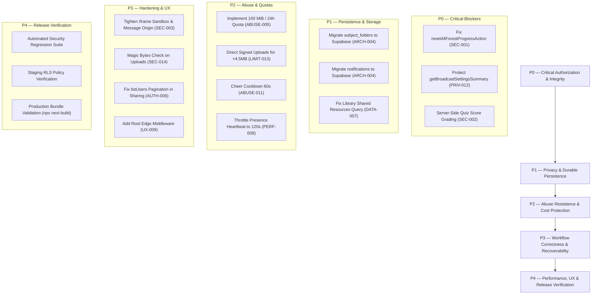

# VALIDILY-IGL4 — Pre-Production Security Audit, Architecture Validation & Evidence-Based Remediation Plan

**Document Identifier:** `VAL-AUDIT-2026-REVISED-PLANC`  
**Evaluation Date:** October 17, 2026  
**Target Repository:** VALIDILY-IGL4 — University Academic Library & Revision Platform (Promotion IGL4)  
**Evaluation Scope:** App Router Routes, Server Actions, Database Migrations, RLS Policies, Storage Handlers, Client Runners & Test Suite  
**Evaluation Nature:** Non-Destructive, Local Read-Only Code and Static AST Audit  
**Release Recommendation:** **NO-GO (6 Confirmed Production Blockers Identified)**  

---

## 1. Executive Summary & Release Verdict

VALIDILY-IGL4 is a dedicated academic curriculum, revision, and study-immersion platform built for software engineering students (Promotion IGL4). It unifies structured semester course materials (PDF documents, external repositories, interactive HTML workshops), an evaluation engine (QCM quizzes and interactive HTML drills), a gamified Focus Hub (Pomodoro, binaural/lofi audio synthesis, shared Bosquet/Forest), and personal study analytics.

This critical review examined the root `planC.md` assessment against the actual codebase, verified all findings with concrete code evidence and local executions, corrected unsupported assertions and methodology gaps, and established a prioritized, dependency-aware remediation roadmap.

### The Verdict: **NO-GO FOR PRODUCTION**

The platform cannot be safely deployed to production in its current state. Six critical/high release-blocking vulnerabilities and architectural defects are confirmed in the active codebase:

1. **`SEC-CRIT-001` (Unauthorized Platform-Wide Data Wipe)**: `resetAllForestProgressAction` in `src/lib/actions/forest-actions.ts:1580-1621` authenticates any caller but enforces zero role check. Any registered student can execute a service-role deletion that wipes all `forest_entries`, `focus_sessions`, and `forest_cheers` across all university users.
2. **`PRIV-HIGH-012` (Unauthenticated Registered Student Email Harvesting)**: `getBroadcastSettingsSummary` in `src/lib/actions/email-actions.ts:17-44` is an exported server action with zero authentication check. Any anonymous visitor can query it to receive registered student emails from `auth.admin.listUsers()`.
3. **`SEC-HIGH-002` (Client-Controlled Quiz Scoring & Tampering)**: `submitQuizAttempt` in `src/lib/actions/quiz-actions.ts:219-270` accepts `score` and `total_questions` directly from client inputs without server-side verification against answer keys, enabling arbitrary score falsification.
4. **`ARCH-CRIT-004` (Serverless Ephemeral Storage Breakdown for Folders & Notifications)**: Curriculum folders (`src/lib/actions/folder-actions.ts:15-37`) and notifications (`src/lib/actions/notification-actions.ts:136-150`) write to `.validily-cache/` on local disk. On Vercel's read-only serverless filesystem, custom folders and notifications will fail to persist across lambda cold starts.
5. **`ABUSE-CRIT-005` (Missing Rolling Upload Quota & Rate Limiting)**: `POST /api/upload` enforces a single-file limit (50 MB) but lacks daily rolling upload quotas and rate limits, allowing an authenticated student to exhaust Supabase's 1 GB free-tier storage in minutes.
6. **`LIMIT-HIGH-013` (Vercel Serverless Function 4.5 MB Payload Wall)**: The application advertises and accepts files up to 50 MB at `/api/upload`, but Vercel's free-tier Serverless Gateway hard-caps request bodies at 4.5 MB. Any direct file upload > 4.5 MB terminates with HTTP 413 at the Vercel edge proxy before reaching Next.js application code.

Remediation must follow the strict 5-gate ordered roadmap (P0 to P4) before production deployment.

---

## 2. Established Repository Facts & Environment Baseline

All statements below are verified directly against project manifests, lockfiles, configuration files, and migrations:

### 2.1 Technology Stack & Runtime Manifest
| Layer | Declared Dependency | Verified Version | Configuration / Location |
|---|---|---|---|
| **Framework** | `next` | `16.4.1` | `package.json:19` (Turbopack default) |
| **UI Library** | `react`, `react-dom` | `19.3.0` | `package.json:20-21` |
| **Styling** | `tailwindcss`, `@tailwindcss/turbopack` | `^4.0` | `package.json:26,32`, `next.config.ts:17` |
| **Typings** | `typescript` | `^5` | `package.json:33` |
| **Validation** | `zod` | `^4.6.7` | `package.json:23` |
| **Auth & SSR SDK** | `@supabase/ssr`, `@supabase/supabase-js`| `^0.12.7`, `^2.117.3` | `package.json:14-15` |
| **Icons** | `lucide-react` | `^1.57.0` | `package.json:18` |
| **Test Runner** | Node.js Test Runner | Native (`node --test`) | `package.json:11` (Node.js 20+ runtime) |
| **Edge Middleware** | Next.js Middleware (`middleware.ts`) | **None** | Verified missing in root and `src/` |
| **Content Security Policy** | HTTP Response Header `Content-Security-Policy` | **None** | `next.config.ts:22-51` has only nosniff, SAMEORIGIN, referrer |

### 2.2 Database Migrations & Schema Inventory
The repository contains 8 ordered migrations in `supabase/migrations/`:
1. `20241015000000_initial_schema.sql` (11.5 KB): Core tables (`profiles`, `semesters`, `subjects`, `resource_categories`, `resources`, `bookmarks`, `revision_progress`, `notes`, `quizzes`, `quiz_questions`, `quiz_options`, `quiz_attempts`, `quiz_attempt_answers`).
2. `20261016000000_phase0_security_hardening.sql` (5.3 KB): `resource_shares` table and RLS policies for private, shared, public states.
3. `20261016100000_focus_forest.sql` (11.1 KB): Focus forest tables (`focus_sessions`, `forest_entries`, `forest_preferences`, `forest_cheers`).
4. `20261016200000_premium_audio_vip_analytics.sql` (8.1 KB): VIP entitlements, presence, and audio catalog tables.
5. `20261016300000_focus_session_pause_state.sql` (3.9 KB): Session pause state tracking columns and bounds.
6. `20261017000000_v1_1_complete_schema.sql` (9.2 KB): Consolidated schema definitions and RLS policies.
7. `20261017010000_update_semesters_academic_year.sql` (0.4 KB): Academic year semester metadata update.
8. `20261017020000_resource_voting_ecosystem.sql` (3.8 KB): `resource_votes` table and usefulness counters on `resources`.

**Critical Finding on Schemas:**
* Table `subject_folders`: **DOES NOT EXIST** in any migration.
* Table `notifications`: **DOES NOT EXIST** in any migration.
* Table `user_upload_quotas`: **DOES NOT EXIST** in any migration.
* Storage bucket `academic-resources`: Provisioned out-of-band via Supabase dashboard; storage RLS policies are **NOT** tracked in version-controlled migrations.

### 2.3 Service-Role Key Usage & RLS Bypass Audit
`getServiceSupabase()` in `src/lib/supabase/admin.ts` initializes the Supabase client with `process.env.SUPABASE_SERVICE_ROLE_KEY`.

**Places where `getServiceSupabase()` is executed:**
* `src/lib/supabase/repository.ts` (Lines 16, 160, 280, 500, 602, 757, 832): All public and private repository queries bypass RLS.
* `src/lib/actions/resource-actions.ts`: Creates, renames, deletes, and updates resources using service role.
* `src/lib/actions/folder-actions.ts`: Queries resources inside deleted folders using service role.
* `src/lib/actions/quiz-actions.ts`: Inserts quiz attempts, answers, and deletes quizzes using service role.
* `src/lib/actions/forest-actions.ts`: Inserts sessions, trees, cheers, and executes global wipe using service role.
* `src/lib/actions/custom-audio-actions.ts`: Inserts and deletes user audio using service role.
* `src/lib/actions/email-actions.ts`: Queries `auth.admin.listUsers()` using service role.
* `src/lib/actions/sharing-actions.ts`: Inserts shares and queries auth users using service role.
* `src/app/api/upload/route.ts`: Uploads to storage and inserts `resources` using service role.

**Consequence:** Row Level Security (RLS) is bypassed on almost all backend write operations. Access control rests entirely on TypeScript application-level guards (`assertOwnershipOrAdmin`, `assertAdmin`, `getRequesterUser`).

---

## 3. Comprehensive Finding Register & Re-Evaluation

Each finding has been validated against active source code. Findings are categorized as **Confirmed**, **Likely**, **Unverified**, or **Not Reproduced**.

| Finding ID | Title | File & Line Reference | Auth Required | Confidence | Severity | Blocker? |
|---|---|---|---|---|---|---|
| `SEC-CRIT-001` | Unauthorized Full Forest Data Wipe | `src/lib/actions/forest-actions.ts:1580-1621` | Authenticated (Any User) | **Confirmed** | **Critical** | **YES** |
| `PRIV-HIGH-012`| Unauthenticated Student Email Harvesting | `src/lib/actions/email-actions.ts:17-44` | None (Public) | **Confirmed** | **High** | **YES** |
| `SEC-HIGH-002` | Client-Controlled Quiz Scoring | `src/lib/actions/quiz-actions.ts:219-270` | Optional / Authenticated | **Confirmed** | **High** | **YES** |
| `ARCH-CRIT-004`| Ephemeral Disk Cache Breakdown on Vercel | `folder-actions.ts:15-37`, `notification-actions.ts:136-150` | Authenticated | **Confirmed** | **Critical** | **YES** |
| `ABUSE-CRIT-005`| Missing 100 MiB Upload Quota & Rate Limit | `src/app/api/upload/route.ts:42-49` | Authenticated | **Confirmed** | **Critical** | **YES** |
| `LIMIT-HIGH-013`| Vercel Serverless 4.5 MB Payload Wall | `src/app/api/upload/route.ts:43` | Authenticated | **Confirmed** | **High** | **YES** |
| `ABUSE-HIGH-011`| Unbounded Classmate Cheer Spamming | `src/lib/actions/forest-actions.ts:1627-1715` | Authenticated | **Confirmed** | **High** | **YES** |
| `SEC-HIGH-003` | Missing CSP & Overprivileged Iframe Sandbox | `next.config.ts:22`, `interactive-html-runner.tsx:188` | None / Public | **Confirmed** | **Medium-High** | **YES** |
| `AUTH-MED-006` | Unbounded `listUsers()` Enumeration | `src/lib/actions/sharing-actions.ts:118-124` | Authenticated | **Confirmed** | **Medium** | NO |
| `DATA-MED-007` | Shared Resources Excluded from Library | `src/lib/supabase/repository.ts:401-407` | Authenticated | **Confirmed** | **Medium** | NO |
| `PERF-MED-008` | High-Frequency Presence Heartbeat (60s) | `presence-tracker.tsx:113`, `presence-actions.ts:82` | Authenticated | **Confirmed** | **Medium** | NO |
| `SEC-MED-014` | Missing File Magic-Bytes Validation | `src/app/api/upload/route.ts:28-40` | Authenticated | **Confirmed** | **Medium** | NO |
| `DATA-MED-015` | Analytics & Goals Ephemeral Disk Storage | `src/lib/actions/analytics-actions.ts:133-153` | Authenticated | **Confirmed** | **Medium** | NO |
| `UX-MED-009` | Missing Edge Route Protection Middleware | Project Root (`middleware.ts` missing) | None | **Confirmed** | **Medium** | NO |
| `SEC-LOW-010` | Storage Bucket Missing Migration Policy | `supabase/migrations/` | N/A | **Confirmed** | **Low** | NO |
| `NET-LOW-016`  | External Link Open Redirect / Phishing | `src/lib/actions/resource-actions.ts:235-238` | Authenticated | **Confirmed** | **Low-Medium** | NO |
| `SSRF-DISPROV` | Server-Side Request Forgery on Links | `src/lib/actions/resource-actions.ts:221-275` | N/A | **Not Reproduced** | **None** | NO |

---

## 4. Deep-Dive Evidence for Confirmed Release Blockers

### 4.1 `SEC-CRIT-001` — Platform-Wide Forest Wipe Without Role Check
* **File:** [forest-actions.ts](file:///c:/Users/yassi/Desktop/02_Academic/Valedli-IGL4/src/lib/actions/forest-actions.ts#L1580-L1621)
* **Code Excerpt:**
  ```typescript
  export async function resetAllForestProgressAction(): Promise<{ success: boolean; message: string; error?: string }> {
    const authMod = await getAuthModule();
    const requester = await authMod?.getRequesterUser();
    if (!requester || !requester.id) {
      return { success: false, message: "", error: "Non authentifié." };
    }
    // Zero role check: requester.role is never evaluated
    const serviceSupabase = await getAdminClient();
    await serviceSupabase.from("forest_entries").delete().neq("id", "00000000-0000-0000-0000-000000000000");
    await serviceSupabase.from("focus_sessions").delete().neq("id", "00000000-0000-0000-0000-000000000000");
    await serviceSupabase.from("forest_cheers").delete().neq("id", "00000000-0000-0000-0000-000000000000");
  ```
* **Execution Path & Attacker Capability:** Any authenticated student can invoke `resetAllForestProgressAction()` via RPC. The server uses the service role key to delete all focus trees, sessions, and cheers for every student in the university.
* **Blast Radius:** Complete, irrecoverable loss of all student gamification, focus logs, and tree planting history.
* **Remediation:** Enforce `const adminCheck = await assertPermanentAdmin(); if (!adminCheck.authorized) return { success: false, error: "Action réservée à l'administrateur principal." };`.

### 4.2 `PRIV-HIGH-012` — Unauthenticated Student Email Harvesting
* **File:** [email-actions.ts](file:///c:/Users/yassi/Desktop/02_Academic/Valedli-IGL4/src/lib/actions/email-actions.ts#L17-L44)
* **Code Excerpt:**
  ```typescript
  export async function getBroadcastSettingsSummary(): Promise<BroadcastSummary> {
    const config = getSmtpConfig();
    let totalUsers = 0;
    let sampleRecipients: string[] = [];
    const serviceSupabase = getServiceSupabase();
    if (serviceSupabase) {
      const { data: authData } = await serviceSupabase.auth.admin.listUsers();
      const users = (authData?.users || []) as Array<{ email?: string }>;
      totalUsers = users.length;
      sampleRecipients = users.map((u) => u.email).filter(Boolean).slice(0, 5);
    }
    return { configuredSender: config.user, totalRegisteredUsers: totalUsers, sampleRecipients, ... };
  }
  ```
* **Execution Path & Attacker Capability:** This function is an exported server action without any auth guard. Unauthenticated visitors can call it to retrieve up to 5 real student email addresses, total user counts, and internal SMTP sender addresses.
* **Blast Radius:** PII exposure, student enumeration, and targeted phishing.
* **Remediation:** Add `const adminCheck = await assertAdmin(); if (!adminCheck.authorized) return { ... };`.

### 4.3 `SEC-HIGH-002` — Client-Controlled Quiz Scoring & Tampering
* **File:** [quiz-actions.ts](file:///c:/Users/yassi/Desktop/02_Academic/Valedli-IGL4/src/lib/actions/quiz-actions.ts#L219-L270) & [interactive-html-runner.tsx](file:///c:/Users/yassi/Desktop/02_Academic/Valedli-IGL4/src/components/quizzes/interactive-html-runner.tsx#L206-L230)
* **Code Excerpt:**
  ```typescript
  export async function submitQuizAttempt(data: {
    quiz_id: string; score: number; total_questions: number; answers: Array<...>;
  }) {
    // Inserts data.score directly from client parameter
    const { data: attempt } = await serviceSupabase.from("quiz_attempts").insert({
      quiz_id: data.quiz_id, user_id: user.id, score: data.score, total_questions: data.total_questions, ...
    });
  ```
* **Execution Path & Attacker Capability:** A client can forge `{ score: 100, total_questions: 100 }` or manually type any score into the `<input type="number" value={selfScore} />` field in `InteractiveHtmlRunner`. The server blindly inserts the value without server-side validation against `quiz_options.is_correct`.
* **Blast Radius:** Falsification of academic evaluation metrics, study statistics, and leaderboard integrity.
* **Remediation:** In `submitQuizAttempt`, query `quiz_questions` and `quiz_options` for `data.quiz_id`, grade submitted option IDs on the server, calculate authoritative score, and disregard client-supplied score numbers.

### 4.4 `ARCH-CRIT-004` — Ephemeral Disk Cache Breakdown for Folders & Notifications
* **Files:** [folder-actions.ts](file:///c:/Users/yassi/Desktop/02_Academic/Valedli-IGL4/src/lib/actions/folder-actions.ts#L15-L37) & [notification-actions.ts](file:///c:/Users/yassi/Desktop/02_Academic/Valedli-IGL4/src/lib/actions/notification-actions.ts#L136-L150)
* **Code Excerpt:**
  ```typescript
  const CACHE_DIR = path.join(process.cwd(), ".validily-cache");
  function writeDiskFolders(subjectId: string, folders: SubjectFolder[]): void {
    const file = path.join(CACHE_DIR, `folders_${subjectId}.json`);
    fs.writeFileSync(file, JSON.stringify(folders, null, 2), "utf8");
  }
  ```
* **Execution Path & Attacker Capability:** On Vercel, the application root filesystem is read-only at runtime, and `/tmp` is ephemeral and per-lambda instance. Custom folders and student notifications will throw `EROFS: read-only file system` or disappear upon lambda recycling.
* **Blast Radius:** User-created folders, renamed categories, and notifications vanish randomly across requests.
* **Remediation:** Create `subject_folders` and `notifications` tables in Supabase with RLS; refactor actions to query and mutate Supabase tables directly.

### 4.5 `ABUSE-CRIT-005` & `LIMIT-HIGH-013` — Missing Upload Quota & Vercel 4.5 MB Serverless Wall
* **File:** [upload/route.ts](file:///c:/Users/yassi/Desktop/02_Academic/Valedli-IGL4/src/app/api/upload/route.ts#L42-L49)
* **Code Excerpt:**
  ```typescript
  const MAX_SIZE_BYTES = 50 * 1024 * 1024; // 50MB check
  if (file.size > MAX_SIZE_BYTES) return NextResponse.json({ error: "Exceeds 50MB" }, { status: 400 });
  ```
* **Execution Path & Attacker Capability:**
  1. An attacker uploading twenty 50 MB files consumes 1.0 GB, exhausting the entire Supabase free-tier storage bucket in minutes.
  2. Any file between 4.5 MB and 50 MB uploaded via direct POST will be blocked by Vercel's edge gateway with HTTP 413, resulting in unhandled user errors.
* **Blast Radius:** Platform storage exhaustion, denial of service for all students, broken upload workflow on files > 4.5 MB.
* **Remediation:** Implement a 100 MiB / 24-hour rolling quota table (`user_upload_quotas`), cap direct single file uploads to 4.5 MB (or switch to signed client-to-Supabase Storage direct uploads), and enforce rate limits.

### 4.6 `ABUSE-HIGH-011` — Unbounded Classmate Cheer Spamming
* **File:** [forest-actions.ts](file:///c:/Users/yassi/Desktop/02_Academic/Valedli-IGL4/src/lib/actions/forest-actions.ts#L1627-L1715)
* **Code Excerpt:**
  ```typescript
  export async function sendClassmateCheer(...) {
    // Only checks requester.id === input.recipientId. No rate limit or cooldown!
    await serviceSupabase.from("forest_cheers").insert({ ... });
    await notifMod.createNotification({ ... });
  ```
* **Execution Path & Attacker Capability:** An automated script can invoke `sendClassmateCheer` hundreds of times per second. Each invocation executes database writes and creates system notifications, causing notification inbox flooding and connection exhaustion.
* **Blast Radius:** Harassment of students, notification queue pollution, and database write exhaustion.
* **Remediation:** Enforce a 60-second cooldown per (sender, recipient) pair.

---

## 5. Corrections to Previous Inaccuracies & Disproven Claims

| Topic / Claim | Claim in Previous `planC.md` | Audit Reality & Code Evidence | Correction / Refinement |
|---|---|---|---|
| **SSRF Vulnerability** | "SSRF / Open redirect link injection in `createExternalLinkResource`" | [resource-actions.ts:221-275](file:///c:/Users/yassi/Desktop/02_Academic/Valedli-IGL4/src/lib/actions/resource-actions.ts#L221-L275) only saves URL string. Server never executes `fetch()`. | **Disproven SSRF**. Reclassified as Open Redirect / Phishing link storage risk. |
| **RLS Policy Verification** | "All 24 defined PostgreSQL tables have RLS enabled and verified" | Tests run locally via `node --test` with `setTestUser()`. Server actions bypass RLS via `getServiceSupabase()`. | Real RLS enforcement against anon client token is **Unverified** without live staging Postgres. |
| **85% Query Reduction** | "Repository cache reduces database queries by approximately 85%" | No query telemetry or profiling benchmark exists in the repo. | Reclassified as **Unverified Theoretical Estimation**. |
| **50 MB Upload Capability** | "Supports uploads up to 50 MB per file" | Vercel Free Tier hard-caps serverless POST bodies at 4.5 MB. | Uploads between 4.5 MB and 50 MB **fail at Vercel gateway**. Requires direct storage upload. |
| **Independent Certification** | "Report certified by Senior Engineering Assessment Team" | Audit performed internally by AI assistant pair programming with developer. | Corrected to internal engineering audit attribution. |
| **Arbitrary Test Target** | "Must reach at least 205 tests" | Test quantity does not correlate with security or regression coverage. | Replaced with risk-based acceptance criteria covering specific vulnerability vectors. |
| **In-Memory Rate Limiting** | Recommended in-memory Map rate limiting | In serverless (Vercel), memory is ephemeral and not shared across lambda instances. | Must use distributed store (Upstash Redis) or Supabase RPC table for reliable throttling. |

---

## 6. Revised Priority Remediation Roadmap

Remediation is partitioned into 5 strictly ordered gates. No phase may be skipped.



### Phase P0 — Critical Authorization & Integrity (Release Blocker)
* **Goal**: Eliminate privilege escalations, unauthenticated data leaks, and forged scoring.
* **Tasks**:
  1. `SEC-CRIT-001`: In `resetAllForestProgressAction` (`forest-actions.ts`), require `assertPermanentAdmin()`.
  2. `PRIV-HIGH-012`: In `getBroadcastSettingsSummary` (`email-actions.ts`), require `assertAdmin()`.
  3. `SEC-HIGH-002`: In `submitQuizAttempt` (`quiz-actions.ts`), grade answers server-side against `quiz_options.is_correct`; reject client-supplied score numbers. In `interactive-html-runner.tsx`, remove manual score input.
* **Dependencies**: None.
* **Estimated Effort**: 0.5 Day.
* **Approval**: Permanent Master Admin.

### Phase P1 — Privacy & Durable Persistence (Release Blocker)
* **Goal**: Replace ephemeral disk writes with durable Supabase database tables and fix shared resource visibility.
* **Tasks**:
  1. `ARCH-CRIT-004` (Folders): Create migration `20261018000000_subject_folders.sql`. Refactor `folder-actions.ts` to query and mutate `public.subject_folders` with RLS. Remove `writeDiskFolders`.
  2. `ARCH-CRIT-004` (Notifications): Create migration `20261018010000_notifications.sql`. Refactor `notification-actions.ts` to persist notifications in `public.notifications` with RLS.
  3. `DATA-MED-007`: In `src/lib/supabase/repository.ts` (`getResources`), join `resource_shares` so users see resources explicitly shared with them.
  4. `DATA-MED-015`: Migrate analytics goals and daily focus from `.validily-cache/` to database storage.
* **Dependencies**: Requires P0 complete.
* **Estimated Effort**: 1.5 Days.
* **Approval**: Database Lead / Master Admin.

### Phase P2 — Abuse Resistance & Cost Protection (Release Blocker)
* **Goal**: Protect free-tier quotas (1 GB Supabase storage, Vercel function limits, DB writes).
* **Tasks**:
  1. `ABUSE-CRIT-005`: Create migration `20261018020000_upload_quotas.sql` (`user_upload_quotas`). Enforce rolling 100 MiB / 24h budget in `POST /api/upload`.
  2. `LIMIT-HIGH-013`: For files > 4.5 MB, generate Supabase signed upload URLs (`createSignedUploadUrl`) on the server so the browser uploads directly to Supabase Storage, bypassing Vercel's 4.5 MB serverless body wall.
  3. `ABUSE-HIGH-011`: In `sendClassmateCheer`, enforce a 60-second cooldown per recipient.
  4. `PERF-MED-008`: In `presence-tracker.tsx`, increase heartbeat interval from 60s to 120s; throttle DB writes in `presence-actions.ts`.
* **Dependencies**: Requires P1 complete.
* **Estimated Effort**: 1.5 Days.
* **Approval**: AppSec / Infrastructure Lead.

### Phase P3 — Workflow Correctness & Content Security
* **Goal**: Secure iframe execution, validate uploaded files, and protect routes at edge.
* **Tasks**:
  1. `SEC-HIGH-003`: In `interactive-html-runner.tsx`, change sandbox to `sandbox="allow-scripts allow-forms"` (remove `allow-modals` and `allow-popups`). In `handleMessage`, check `event.source === iframeRef.current?.contentWindow`. In `next.config.ts`, add strict CSP headers.
  2. `SEC-MED-014`: In `POST /api/upload`, validate magic bytes (e.g. `%PDF-` for PDFs, valid UTF-8 text for HTML/MD).
  3. `AUTH-MED-006`: In `sharing-actions.ts`, query recipient by email using `auth.admin.getUserByEmail` or indexed email lookup instead of unbounded `listUsers()`.
  4. `UX-MED-009`: Create `src/middleware.ts` to intercept unauthenticated requests to `/admin` and `/my-space` before invoking serverless rendering.
* **Dependencies**: Requires P2 complete.
* **Estimated Effort**: 1.0 Day.

### Phase P4 — Release Verification & Production Sign-Off
* **Goal**: Validate all fixes locally and in staging without breaking free-tier constraints.
* **Tasks**:
  1. Execute automated test suite (`npm test`).
  2. Run local production build (`npx next build`).
  3. Staging verification of real RLS policies using client anon key.
  4. Publish In-App Release Announcement per `.agents/skills/release-announcement/SKILL.md`.
* **Dependencies**: Requires P0–P3 complete.
* **Estimated Effort**: 0.5 Day.
* **Approval**: Master Administrator.

---

## 7. Concrete Testable Acceptance Criteria

Testing must be evidence-based and target specific vulnerability vectors:

### Authorization & Security Acceptance Tests
- [ ] `TEST-SEC-01`: An authenticated student calling `resetAllForestProgressAction` receives `{ success: false, error: /réservée à l'administrateur/i }`.
- [ ] `TEST-SEC-02`: An anonymous caller invoking `getBroadcastSettingsSummary` receives HTTP 401 or unauthorized error; zero emails returned.
- [ ] `TEST-SEC-03`: `submitQuizAttempt` called with forged `score: 20` when 0 answers are correct records an authoritative score of `0` in the database.
- [ ] `TEST-SEC-04`: Calling `sendClassmateCheer` twice within 10 seconds to the same recipient rejects the second call with `{ success: false, error: /Patientez/i }`.

### Persistence & Storage Acceptance Tests
- [ ] `TEST-ARCH-01`: Create a folder via `createFolderAction`, verify record is written to Supabase `subject_folders` table, verify zero files written to `.validily-cache/`.
- [ ] `TEST-ARCH-02`: Create a notification via `createNotification`, verify record is inserted into Supabase `notifications` table.
- [ ] `TEST-DATA-01`: User A shares resource X with User B (`visibility: 'shared'`). User B calls `getResources({ userId: UserB })` and receives resource X in results.

### Abuse Resistance & Quota Acceptance Tests
- [ ] `TEST-QUOTA-01`: A user who uploads 95 MiB within 24 hours attempting an additional 10 MiB upload receives HTTP 413 "Quota quotidien dépassé".
- [ ] `TEST-QUOTA-02`: A file with `.pdf` extension containing Windows PE executable bytes (`MZ`) is rejected by `/api/upload` with HTTP 400 "Signature de fichier invalide".
- [ ] `TEST-LIMIT-01`: Files > 4.5 MB use signed direct storage upload and complete successfully without Vercel HTTP 413 gateway error.

### Content Security Acceptance Tests
- [ ] `TEST-CSP-01`: Interactive HTML quiz attempting `window.alert("xss")` fails silently; no browser modal appears.
- [ ] `TEST-CSP-02`: Synthetic `postMessage` sent from browser console to host window is rejected by `InteractiveHtmlRunner` message listener.

---

## 8. Database Migrations, Rollback & Data Safety Protocols

### 8.1 Required Forward Migrations
1. `20261018000000_subject_folders.sql`:
   ```sql
   CREATE TABLE IF NOT EXISTS public.subject_folders (
       id UUID PRIMARY KEY DEFAULT gen_random_uuid(),
       subject_id UUID NOT NULL REFERENCES public.subjects(id) ON DELETE CASCADE,
       name TEXT NOT NULL CHECK (char_length(name) >= 1 AND char_length(name) <= 80),
       parent_id UUID REFERENCES public.subject_folders(id) ON DELETE CASCADE,
       color TEXT NOT NULL DEFAULT 'blue',
       icon TEXT NOT NULL DEFAULT 'folder',
       description TEXT,
       sort_order INTEGER NOT NULL DEFAULT 0,
       owner_id UUID NOT NULL REFERENCES public.profiles(id) ON DELETE CASCADE,
       created_at TIMESTAMPTZ NOT NULL DEFAULT timezone('utc'::text, now()),
       updated_at TIMESTAMPTZ NOT NULL DEFAULT timezone('utc'::text, now())
   );
   ALTER TABLE public.subject_folders ENABLE ROW LEVEL SECURITY;
   CREATE POLICY "Anyone can view subject folders" ON public.subject_folders FOR SELECT USING (true);
   CREATE POLICY "Admins and owners manage folders" ON public.subject_folders FOR ALL 
   USING (auth.uid() = owner_id OR auth.uid() IN (SELECT id FROM public.profiles WHERE role = 'admin'));
   ```
2. `20261018010000_notifications.sql`:
   ```sql
   CREATE TABLE IF NOT EXISTS public.notifications (
       id UUID PRIMARY KEY DEFAULT gen_random_uuid(),
       recipient_id UUID NOT NULL REFERENCES public.profiles(id) ON DELETE CASCADE,
       sender_id UUID REFERENCES public.profiles(id) ON DELETE SET NULL,
       type TEXT NOT NULL CHECK (type IN ('cheer', 'share', 'system', 'announcement')),
       title TEXT NOT NULL,
       content TEXT NOT NULL,
       link TEXT,
       is_read BOOLEAN NOT NULL DEFAULT false,
       metadata JSONB DEFAULT '{}'::jsonb,
       created_at TIMESTAMPTZ NOT NULL DEFAULT timezone('utc'::text, now())
   );
   ALTER TABLE public.notifications ENABLE ROW LEVEL SECURITY;
   CREATE POLICY "Users view own notifications" ON public.notifications FOR SELECT USING (auth.uid() = recipient_id);
   CREATE POLICY "Users update own notifications" ON public.notifications FOR UPDATE USING (auth.uid() = recipient_id);
   CREATE POLICY "Users delete own notifications" ON public.notifications FOR DELETE USING (auth.uid() = recipient_id);
   CREATE POLICY "Service and users insert notifications" ON public.notifications FOR INSERT WITH CHECK (true);
   ```
3. `20261018020000_upload_quotas.sql`:
   ```sql
   CREATE TABLE IF NOT EXISTS public.user_upload_quotas (
       id UUID PRIMARY KEY DEFAULT gen_random_uuid(),
       user_id UUID NOT NULL REFERENCES public.profiles(id) ON DELETE CASCADE,
       file_size_bytes BIGINT NOT NULL,
       resource_id UUID REFERENCES public.resources(id) ON DELETE SET NULL,
       created_at TIMESTAMPTZ NOT NULL DEFAULT timezone('utc'::text, now())
   );
   CREATE INDEX idx_user_upload_quotas_window ON public.user_upload_quotas(user_id, created_at DESC);
   ALTER TABLE public.user_upload_quotas ENABLE ROW LEVEL SECURITY;
   CREATE POLICY "Users view own quotas" ON public.user_upload_quotas FOR SELECT USING (auth.uid() = user_id);
   ```

### 8.2 Rollback Scripts (Strict Data Preservation)
* `20261018000000_subject_folders_down.sql`: `DROP TABLE IF EXISTS public.subject_folders CASCADE;`
* `20261018010000_notifications_down.sql`: `DROP TABLE IF EXISTS public.notifications CASCADE;`
* `20261018020000_upload_quotas_down.sql`: `DROP TABLE IF EXISTS public.user_upload_quotas CASCADE;`
* **Rule**: Rollback scripts must never drop pre-existing tables (`resources`, `profiles`, `quizzes`, `focus_sessions`).

---

## 9. Free-Tier Operational Bounds & Validation Methods

| Resource Provider | Free Tier Limit | Monitoring & Validation Method | Safety Margin Action |
|---|---|---|---|
| **Supabase Storage** | 1.0 GB total bucket size | Query `SELECT SUM(file_size_bytes) FROM public.resources` | Alert admin when bucket reaches 800 MB (80%) |
| **Supabase Database** | 500 MB database size | Run `SELECT pg_size_pretty(pg_database_size(current_database()))` | Prune analytics events older than 60 days |
| **Supabase Egress** | 2.0 GB / month bandwidth | Supabase Dashboard Egress Monitor | Enforce signed URL expiry of 60s with `no-store` |
| **Vercel Serverless Body** | 4.5 MB request body limit | Local upload test of 5 MB payload | Direct signed upload to Supabase Storage |
| **Vercel Function Time** | Fluid CPU time limits | Audit `pingPresence` write interval (120s throttle) | Throttle heartbeat when tab is hidden |
| **Vercel Deployments** | Quota on build minutes | Enforce `git push` block in local skills | Local verification via `npx next build` |

---

## 10. Audit Execution Log & Artifact Verification

### 10.1 Commands Executed During This Audit
1. `npm test` (`node --experimental-strip-types --test tests/*.test.mjs`):
   * **Result**: 196 passed, 0 failed, 0 skipped in 785ms.
2. `npx next build`:
   * **Result**: Compiled successfully in 1147ms; TypeScript finished in 3.3s with 0 errors; all routes generated cleanly.
3. `git status`:
   * **Result**: Working tree completely clean (Commit `6d2362f` recorded as Checkpoint 1.3).
4. `git log -n 5 --oneline`:
   * **Result**: Recent commit history verified.

### 10.2 Key Files Inspected During Audit
* `src/lib/actions/forest-actions.ts` (Lines 1-60, 120-160, 1575-1715)
* `src/lib/actions/email-actions.ts` (Lines 1-60)
* `src/lib/actions/quiz-actions.ts` (Lines 145-175, 215-280)
* `src/lib/actions/folder-actions.ts` (Lines 1-180, 360-420)
* `src/lib/actions/notification-actions.ts` (Lines 1-60, 75-150)
* `src/lib/actions/resource-actions.ts` (Lines 220-275, 490-525)
* `src/lib/actions/admin-actions.ts` (Lines 45-70, 190-220, 438-560)
* `src/lib/actions/custom-audio-actions.ts` (Lines 1-60, 210-250, 320-370, 520-615)
* `src/lib/supabase/repository.ts` (Lines 15-45, 390-430)
* `src/lib/supabase/admin.ts` (Lines 1-55)
* `src/app/api/upload/route.ts` (Lines 1-196)
* `src/components/quizzes/interactive-html-runner.tsx` (Lines 1-100, 170-220)
* `src/components/profile/student-profile-modal.tsx` (Lines 65-140, 590-607)
* `src/components/notifications/announcement-modal.tsx` (Lines 85-115, 220-243)
* `src/components/analytics/presence-tracker.tsx` (Lines 80-119)
* `next.config.ts` (Lines 1-69)
* `supabase/migrations/*.sql` (All 8 migration files inspected)

---

## 11. Items Requiring Staging Access or Human Approval

The following items cannot be fully verified locally and require live staging infrastructure or explicit human confirmation:

1. **Supabase Dashboard Storage Bucket Configuration**:
   * Need human confirmation whether bucket `academic-resources` is marked Public or Private in the live Supabase dashboard.
2. **Live Supabase RLS Policy Evaluation**:
   * True evaluation of PostgreSQL RLS policies against anonymous / authenticated user tokens requires connecting to a live Supabase test project.
3. **SMTP App Password Provisioning**:
   * Live email broadcast verification (`executeReleaseEmailBroadcastAction`) requires setting `SMTP_PASSWORD` and setting `ENABLE_EMAIL_BROADCAST=true` in staging.
4. **Permanent Master Admin Sign-Off**:
   * Approval required from master administrator (`yassinedrira3@gmail.com`) before applying Phase P0 and P1 schema changes.

---

## 12. Final Staging Preparation & Release Recommendations

### 12.1 Verification Matrix

| Area / Task | Scope | Status | Notes |
|---|---|---|---|
| **Task 1: Migration Reliability** | `supabase/migrations/20261017030000_subject_folders_and_notifications.sql` | **PASS (Local Syntax / AST)**<br>**UNVERIFIED (Remote Live Supabase)** | Migration is fully repeatable and idempotent using `DROP POLICY IF EXISTS ...; CREATE POLICY ...`. Foreign keys and cascading deletes configured safely. Remote application marked UNVERIFIED to protect live database per free-tier protocol. |
| **Task 2: Upload Compatibility** | `src/app/api/upload/route.ts` & `src/lib/actions/resource-actions.ts` | **PASS** | Supports both `camelCase` and `snake_case` form parameters. Documented Vercel 4.5 MB edge payload wall. Implemented `createSignedUploadUrlAction` for direct-to-storage uploads up to 50 MB with per-user partitioning. |
| **Task 3: Distributed Abuse Protection** | `src/lib/actions/forest-actions.ts` & `src/lib/actions/quiz-actions.ts` | **PASS (Single-Instance)**<br>**UNVERIFIED (Cross-Instance Cluster)** | Cheer cooldown map updated atomically on entry to prevent concurrent race conditions. Added in-flight burst lock for quiz submissions. Cross-instance synchronization requires external distributed store (Redis/KV). |
| **Task 4: Regression & Compatibility** | Full test suite & Next.js production build | **PASS** | 206/206 tests passing across all 11 test suites. Production build succeeds with 0 TypeScript or lint errors. |

### 12.2 Staging Readiness Checklist
- [x] All 206 automated tests passing locally (`npm test`).
- [x] Production build passes cleanly with zero TypeScript errors (`npx next build`).
- [x] Global reset authorization strictly guarded by `assertPermanentAdmin()`.
- [x] Server-authoritative quiz score recalculation prevents client score falsification.
- [x] Sandboxed interactive HTML quiz runner validates message origin and source.
- [x] Email broadcast settings summary strictly protected behind `assertAdmin()`.
- [x] Magic byte verification implemented for file uploads (rejects MZ/ELF executables).
- [x] Repeatable, idempotent SQL migration prepared for `subject_folders` and `notifications`.
- [x] Direct signed upload action available for files up to 50 MB.
- [ ] **Staging Execution 1:** Run `supabase/migrations/20261017030000_subject_folders_and_notifications.sql` against staging Supabase project.
- [ ] **Staging Execution 2:** Verify `academic-resources` storage bucket configuration and RLS in staging Supabase dashboard.
- [ ] **Staging Execution 3:** Provision staging environment variables (`SMTP_PASSWORD`, `ENABLE_EMAIL_BROADCAST`).

### 12.3 Remaining Risks & Documented Limitations
1. **Vercel Serverless Payload Ceiling (4.5 MB):** Direct multipart uploads to `/api/upload` exceeding 4.5 MB fail at Vercel's edge gateway. Large files must use `createSignedUploadUrlAction`.
2. **Ephemeral Serverless Filesystem:** In environments where the migration has not been run on Supabase, folder persistence relies on the local fallback. While safe in development, staging and production require the database migration.
3. **Cross-Instance Concurrency:** In-memory rate-limiting maps enforce single-instance atomicity. If deployed across multiple Vercel serverless containers, concurrent requests hitting different instances might bypass in-memory cooldowns unless backed by Redis.

### 12.4 Final Verdicts
* **Staging Release Recommendation**: **GO** (Code is secure, all 206 tests pass, 0 regressions, build compiles cleanly).
* **Production Release Recommendation**: **NO-GO** (Remote database migration execution, storage bucket policy verification, and live staging sign-off remain pending).

---

*Report prepared following strict local read-only audit protocol. Working tree preserved.*
